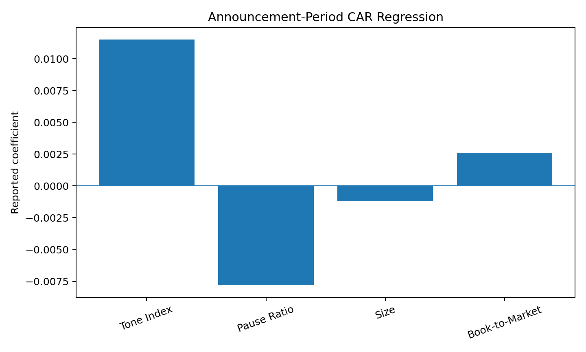
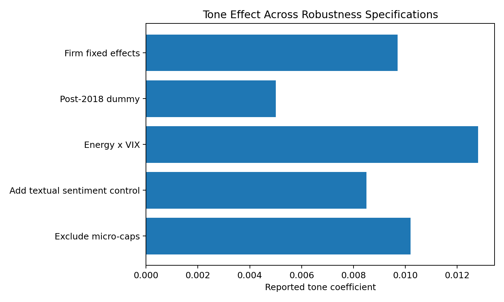

# Acoustic Features of Earnings Calls and Market Reactions

This repository accompanies my research paper **“Acoustic Features of Corporate Conference Calls and Market Reactions (2010–2025).”** The study asks whether nonverbal features of management speech — pitch, vocal energy, and pauses — contain information about short-term market reactions around earnings calls.

> **Research status:** SSRN (2025)

[Read the full paper](paper/Acoustic_Earnings_Call_Paper.pdf)

## Research question

Do acoustic cues in corporate earnings calls help explain announcement-period returns and trading activity after controlling for systematic risk, textual sentiment, and firm characteristics?

The paper studies approximately **82,000 earnings calls** from roughly **7,200 U.S. firms** over 2010–2025. It links call-level acoustic measures to CRSP market outcomes and Fama–French risk factors.

## Empirical framework

The research design follows this pipeline:

1. Segment CEO/CFO speech using transcript timestamps.
2. Extract pitch, vocal energy, and pause ratio from call audio.
3. Standardize features and combine pitch and energy into a composite **Tone Index**.
4. Estimate factor-adjusted abnormal returns and cumulative abnormal returns (CAR) around call dates.
5. Regress CAR and trading-volume changes on tone and pause measures with firm controls and industry effects.
6. Test robustness across textual-sentiment controls, micro-cap exclusions, volatility interactions, subperiods, and fixed-effect specifications.

## Reported results

The paper reports a positive association between vocal tone and announcement-period market response, while greater hesitation is associated with weaker reactions.

| Variable | CAR coefficient | t-statistic | Direction |
|---|---:|---:|---|
| Tone Index | +0.0115 | 2.94 | Positive |
| Pause Ratio | -0.0078 | -2.53 | Negative |
| Size | -0.0012 | -1.89 | Negative |
| Book-to-Market | +0.0026 | 1.84 | Positive |



The paper also reports that higher tone and energy are associated with greater trading activity, while the tone effect is weaker in the post-2018 subperiod.



## Repository contents

- `paper/` — full research paper.
- `src/acoustic_features.py` — transparent feature-engineering utilities for pitch, energy, pauses, and a tone index.
- `src/factor_model.py` — Fama–French five-factor expected-return and abnormal-return helpers.
- `src/regressions.py` — illustrative event-level regression utilities.
- `src/make_figures.py` — recreates visual summaries from the paper's reported tables.
- `results/` — paper-reported regression and robustness results in CSV form.
- `figures/` — visual summaries of the reported findings.

## Reproducibility note

The commercial Refinitiv audio archive and licensed CRSP/WRDS data used in the research are **not redistributed in this repository**. The code provides a transparent implementation template for the empirical workflow, while the included CSV files and figures reproduce **reported summary results from the paper** rather than claiming to regenerate the licensed raw-data analysis from public files.

## Research and implementation note

I developed the research question, empirical design, model-selection reasoning, interpretation, and manuscript. **AI-assisted programming tools were used to help translate the methodology into code and support implementation/debugging while I developed my programming proficiency.**

The repository is intended to make the quantitative reasoning and workflow behind the research easier to inspect and discuss.

## Run locally

```bash
pip install -r requirements.txt
python src/make_figures.py
```

The core functions in `src/` can be imported into a notebook or analysis pipeline once appropriately licensed call-audio and market data are supplied.
